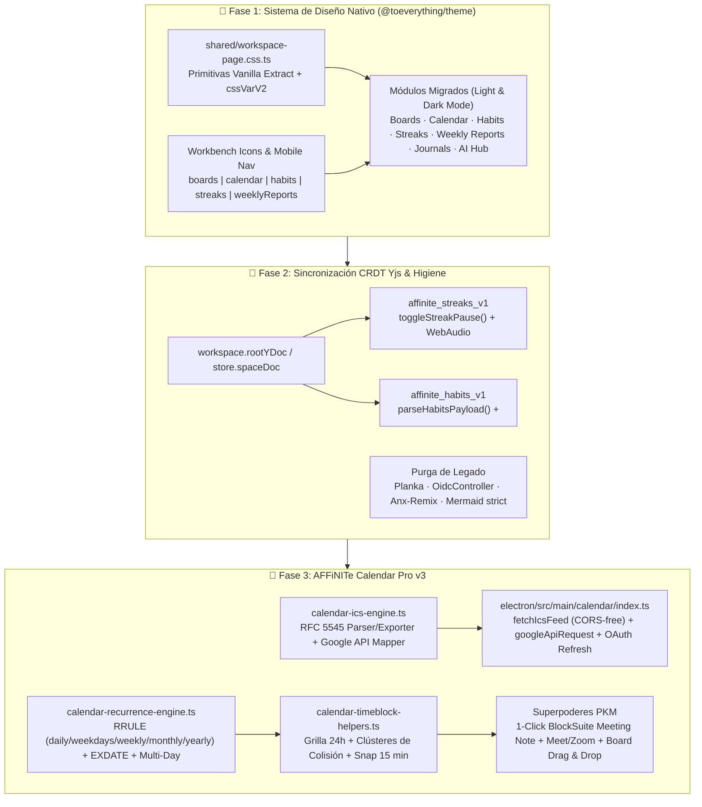
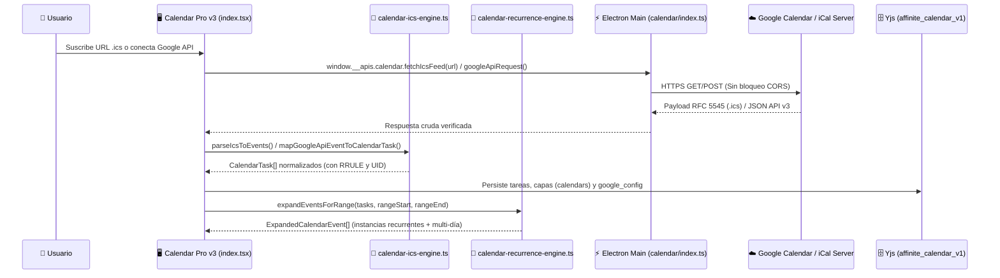

# 🚀 AFFiNITe v0.30.0 — Unificación del Sistema de Diseño, Sincronización CRDT Yjs y Calendar Pro v3 (Paridad Google Calendar + Superpoderes PKM)

> 💡 **Resumen Ejecutivo (TL;DR)**
> Esta nota maestra documenta de principio a fin la ingeniería realizada en la sesión de lanzamiento de **AFFiNITe v0.30.0**:
> 1. **Auditoría Integral y Unificación del Sistema de Diseño (`@toeverything/theme` + Vanilla Extract `.css.ts`)**: Migración de todos los módulos personalizados (`Boards`, `Calendar`, `Habits`, `Streaks`, `Weekly Reports`, `Journals`, `AI Hub`, `Shell Fallback`) a tokens semánticos `cssVarV2` con soporte 100% nativo para **Light Mode y Dark Mode**, modales `@affine/component` (`<Modal>`, `useConfirmModal()`) e íconos nativos de `Workbench`.
> 2. **Corrección de Sincronización CRDT (Yjs) y Lógica de Dominio**: Reparación de la pausa/reanudación matemática en `Streaks` (`toggleStreakPause`), unificación de esquemas e IDs en `Habits` (`parseHabitsPayload`, `store.spaceDoc`), eliminación de efectos secundarios en fase de render en `Weekly Reports` y endurecimiento de seguridad en `Mermaid` (`securityLevel: 'strict'`) y limpieza de código legado (`Planka`, `OidcController`, `Anx-Remix`).
> 3. **AFFiNITe Calendar Pro v3 (Compatible con Google Calendar + Superpoderes PKM)**: Construcción de un motor completo **RFC 5545 iCalendar (`.ics`)**, puente IPC en Electron Main sin restricciones CORS, sincronización bidireccional con **Google Calendar API v3**, motor de recurrencia (`RRULE` + `EXDATE`) y eventos multi-día, grilla de 24 horas con algoritmo de colisiones lado a lado, drag-to-move, redimensionado de 15 min, 6 vistas con atajos de teclado y vinculación en 1 clic con notas de reunión en BlockSuite.

---

## 🧭 1. Mapa Arquitectónico de la Sesión

---

## 🎨 2. Parte I — Auditoría del Repositorio y Unificación del Sistema de Diseño

### 2.1. Diagnóstico Inicial (Problema Raíz)
Durante la auditoría exhaustiva del repositorio se identificó que las vistas agregadas en iteraciones previas utilizaban estilos en línea (`style={{ ... }}`) o etiquetas `<style>` inyectadas en el DOM con paletas oscuras fijas (`#0b1120`, `#0f172a`, `#181b22`, `#f8fafc`).
* **Efecto en Modo Claro (Light Mode)**: En `Streaks`, el texto blanco `#ffffff` sobre fondo transparente resultaba invisible; en `Boards`, `Habits`, `Calendar` y `Weekly Reports`, los contenedores permanecían forzados en gris/azul oscuro mientras el resto de AFFiNITe cambiaba a modo claro.
* **Diálogos y Modales**: Varios módulos utilizaban `window.confirm()` nativo del navegador (bloqueante y ajeno al diseño de la app) y modales `
` manuales en lugar de `<Modal>` y `useConfirmModal()` de `@affine/component`.

### 2.2. Solución Arquitectónica: Vanilla Extract (`.css.ts`) + Tokens Semánticos `cssVarV2`
Se creó una capa base compartida en `packages/frontend/core/src/desktop/pages/workspace/shared/workspace-page.css.ts` y hojas `.css.ts` dedicadas por módulo:

| Módulo / Vista | Hoja Vanilla Extract Creada / Actualizada | Componente Principal | Mejoras Clave de UI y UX |
| :--- | :--- | :--- | :--- |
| **Primitivas Compartidas** | `shared/workspace-page.css.ts` | Todos los módulos del workspace | Contenedores de página, grillas responsivas, tarjetas elevadas, píldoras, botones e inputs con `cssVarV2`. |
| **Workbench & Sidebar** | `modules/workbench/constants.tsx` | `root-app-sidebar/index.tsx` | Íconos nativos registrados (`boards`, `calendar`, `habits`, `streaks`, `weeklyReports`) + paridad en navegación móvil. |
| **Tableros (`Boards`)** | `boards/boards.css.ts` | `boards/index.tsx` | Eliminación de `<style>` de 652 líneas, reemplazo de URLs de Unsplash por gradientes locales offline-safe (`sanitizeBoardBackground`), `<Modal>` y `useConfirmModal()`. |
| **Hábitos (`Habits`)** | `habits/habits.css.ts` | `habits/index.tsx` | Tarjetas adaptativas Light/Dark, modal nativo `<Modal>`, tipado estricto y sincronización en vivo con `/habit` en el editor. |
| **Rachas (`Streaks`)** | `streaks/streaks.css.ts` | `streaks/index.tsx` | Incorporación de `<ViewHeader>` / `<ViewBody>`, visibilidad perfecta en Light Mode, `<Modal>` y `useConfirmModal()`. |
| **Reportes Semanales** | `weekly-reports/weekly-reports.css.ts` | `weekly-reports/index.tsx` | Corrección de jerarquía `<ViewTitle>` / `<ViewIcon>`, tarjetas temáticas y carga segura de documentos con `useEffect`. |
| **Diarios (`Journals`)** | `journals/index.css.ts` | `journals/index.tsx` | Selector segmentado `Diario` / `Semanal (YYYY-Www)` y subtítulo semanal estilizados con `cssVarV2`. |
| **AI Hub & Ajustes IA** | `chat/index.css.ts`, `ai-model-selector.css.ts` | `chat/index.tsx`, `ai-model-selector.tsx` | Chips de prompts rápidos, selector de modelo y panel de telemetría unificados + confirmación con `useConfirmModal()`. |
| **Barra de Pestañas** | `shell-fallback.css.ts` | `shell-fallback.tsx` | Migración completa de estilos inline a Vanilla Extract y reemplazo de `✕` por `<CloseIcon />`. |

---

## 🔧 3. Parte II — Correcciones Críticas de Sincronización CRDT (Yjs), Lógica y Seguridad

### 3.1. Matemática de Pausa y Reanudación en `Streaks` (`streaks-calculator.ts`)
Anteriormente, pausar un contador en `/streaks` solo cambiaba la bandera `status = 'paused'`, pero como el progreso se calculaba contra `targetDateTime` fijo, el tiempo seguía descontándose mientras estaba en pausa.

Se diseñó e implementó `toggleStreakPause(streak, nowDate)` bajo **TDD**:
1. **Al pausar en el instante $t_{\text{pause}}$**:
   Se almacena `pausedAt = t_pause.toISOString()` y `calculateStreakProgress(streak, now)` evalúa el tiempo efectivo como:
   $$t_{\text{eff}} = \begin{cases} \min(t_{\text{now}}, t_{\text{pause}}) & \text{si } \text{status} = \text{'paused'} \land t_{\text{pause}} \neq \varnothing \\ t_{\text{now}} & \text{en caso contrario} \end{cases}$$
2. **Al reanudar en el instante $t_{\text{resume}}$**:
   Se calcula la duración de la pausa $\Delta t_{\text{pause}} = \max(0, t_{\text{resume}} - t_{\text{pause}})$ y se desplazan tanto el inicio como la meta para conservar intacta la duración total $D = t_{\text{target}} - t_{\text{start}}$:
   $$t'_{\text{start}} = t_{\text{start}} + \Delta t_{\text{pause}}, \qquad t'_{\text{target}} = t_{\text{target}} + \Delta t_{\text{pause}}$$

### 3.2. Unificación del Motor de Hábitos y el Bloque `<affine-habit-preview>`
Se resolvieron tres causas raíz que impedían la sincronización entre la página `/habits` y los bloques insertados con `/habit` en el editor:
* **Acceso al `Y.Doc` raíz en BlockSuite v0.29**: En `habit-preview.ts` se actualizó `getYMap()` para resolver `this.model.store.spaceDoc.getMap('affinite_habits_v1')` (en lugar de la ruta obsoleta `doc.docCollection.doc`).
* **Normalización de Payload (`parseHabitsPayload`)**: Soporta de forma transparente tanto cadenas JSON serializadas como arreglos nativos en `Y.Map`.
* **Mapa de Migración de IDs (`LEGACY_HABIT_ID_MAP`)**: Unifica alias históricos (`h-read` $\leftrightarrow$ `habit-reading`, `h-water` $\leftrightarrow$ `habit-water`, `h-exercise` $\leftrightarrow$ `habit-exercise`, `h-meditate` $\leftrightarrow$ `habit-meditation`, `h-code` $\leftrightarrow$ `habit-code`).

### 3.3. Higiene Arquitectónica y Seguridad
* **Eliminación de código muerto de `Planka` y `OIDC`**: Se eliminaron `planka-view.ts`, los handlers IPC residuales, el interceptor falso de `/boards/` en `link-preview-service.ts`, y el controlador `oidc.controller.ts` + `oidc.spec.ts`.
* **Mermaid Hardening**: Cambio de `securityLevel: 'loose'` a `securityLevel: 'strict'` en `mermaid-preview.ts` para prevenir vectores XSS en diagramas.
* **Limpieza de artefactos**: Eliminación de binarios antiguos (`.apk`, `.AppImage`), `package.json.bak` y logs de compilación rastreados por error.

---

## 📅 4. Parte III — AFFiNITe Calendar Pro v3 (Google Calendar + Superpoderes PKM)

Con la base visual y arquitectónica en `v0.30.0`, se rediseñó el módulo `/calendar` para alcanzar **paridad funcional con Google Calendar** e integrar **superpoderes nativos de gestión de conocimiento personal (PKM)**.

### 4.1. Arquitectura de 4 Motores + Puente IPC en Electron

### 4.2. Motor RFC 5545 iCalendar y Mapeador Google Calendar API (`calendar-ics-engine.ts`)
* **Parser RFC 5545 (`parseIcsToEvents`)**:
  * Despliega líneas plegadas (*line unfolding* `\r?\n[ \t]`).
  * Procesa bloques `BEGIN:VEVENT ... END:VEVENT` extrayendo `UID`, `SUMMARY`, `DESCRIPTION`, `LOCATION`, `URL`, `X-GOOGLE-CONFERENCE` y detecta automáticamente enlaces de **Google Meet / Zoom / Teams** dentro de la descripción o ubicación.
  * Soporta fechas de día completo (`DTSTART;VALUE=DATE:YYYYMMDD`) convirtiendo el `DTEND` exclusivo de RFC 5545 al `endDate` inclusivo de AFFiNITe ($\text{endDate} = \text{DTEND} - 1\text{ día}$), fechas flotantes locales (`YYYYMMDDTHHmmss`), zonas horarias `TZID=...` y tiempos UTC (`Z`).
  * Convierte reglas `RRULE` (`FREQ`, `INTERVAL`, `BYDAY`, `UNTIL`, `COUNT`) y múltiples cabeceras `EXDATE` a la estructura tipada `RecurrenceRule`.
* **Exportador RFC 5545 (`exportEventsToIcs`)**:
  * Genera archivos `.ics` estándar (`VERSION:2.0`, `PRODID:-//AFFiNITe//Calendar Pro v3//EN`) con `RRULE`, `EXDATE` y bloques `VALARM` para recordatorios, listos para importarse en Google Calendar, Apple Calendar, Outlook o Thunderbird.
* **Sincronización Bidireccional Google Calendar API v3**:
  * `mapGoogleApiEventToCalendarTask` y `mapCalendarTaskToGoogleApiEvent` transforman eventos entre el esquema REST v3 de Google (`summary`, `start.dateTime`/`start.date`, `hangoutLink`, `conferenceData`, `recurrence`) y `CalendarTask`.
  * `buildGoogleCalendarTemplateUrl` genera enlaces directos `calendar.google.com/calendar/render?action=TEMPLATE` para publicar cualquier evento en 1 clic sin configurar tokens.

### 4.3. Puente IPC en Electron Main (`packages/frontend/apps/electron/src/main/calendar/index.ts`)
Los navegadores bloquean por CORS la descarga directa de feeds privados `.ics` de Google Calendar (`https://calendar.google.com/calendar/ical/.../basic.ics`). Para solucionarlo de raíz en escritorio:
* **`fetchIcsFeed`**: Normaliza esquemas `webcal://` y `webcals://` a `https://`, aplica un timeout seguro de `15000 ms` y descarga el feed desde el proceso principal de Node/Electron sin restricciones CORS.
* **`googleApiRequest`**: Ejecuta peticiones autenticadas (`GET`, `POST`, `PATCH`, `PUT`, `DELETE`) contra `https://www.googleapis.com/calendar/v3/*`.
* **`refreshGoogleAccessToken`**: Renueva tokens OAuth 2.0 contra `https://oauth2.googleapis.com/token` usando `refresh_token`.

### 4.4. Motor de Recurrencia (`RRULE`) y Eventos Multi-Día (`calendar-recurrence-engine.ts`)
La función `expandEventsForRange(tasks, rangeStartStr, rangeEndStr)` proyecta cualquier conjunto de tareas maestras sobre la ventana temporal activa:
* **Frecuencias soportadas**: `'none'`, `'daily'`, `'weekdays'` (Lunes a Viernes, ISO $1\dots 5$), `'weekly'` (con soporte de arreglo `byWeekday`), `'monthly'` y `'yearly'`.
* **Controles de serie**: Respeta `interval`, fecha límite `until`, límite de ocurrencias `count` y lista de exclusiones `exdates`.
* **Eliminación granular en series**: `excludeRecurringOccurrence(task, dateToExclude)` permite borrar **"Solo esta fecha"** agregando la fecha a `recurrence.exdates` sin destruir el resto de la serie, o borrar **"Toda la serie"**.
* **Eventos Multi-Día**: Expande eventos con `endDate > date` generando instancias por día con metadatos `isMultiDay: true`, `spanDayIndex` ($1\dots N$) y `spanTotalDays` ($N$).

### 4.5. Grilla de 24 Horas, Algoritmo de Colisiones Lado a Lado y Snap de 15 Minutos (`calendar-timeblock-helpers.ts`)
1. **Posicionamiento Vertical en Grilla de 24h ($00:00 - 23:59$)**:
   Con $H_{\text{start}} = 0$ y $P_h = 60\text{ px/hora}$ ($1\text{ px/minuto}$), un evento con inicio $m_{\text{start}}$ y fin $m_{\text{end}}$ (en minutos desde las $00:00$) se posiciona en:
   $$\text{top} = (m_{\text{start}} - 60 H_{\text{start}}) \cdot \frac{P_h}{60}, \qquad \text{height} = \max\left(22,\; (m_{\text{end}} - m_{\text{start}}) \cdot \frac{P_h}{60}\right)$$
2. **Algoritmo de Clústeres de Colisión (`computeOverlappingEventsLayout`)**:
   * Ordena los eventos del día por minuto de inicio ascendente (y mayor duración en caso de empate).
   * Agrupa eventos cuyos intervalos $[m_{\text{start}}, m_{\text{end}})$ se solapan en **clústeres conexos** (cerrando un clúster cuando $m_{\text{start}}^{(i)} \ge \max_{j < i} m_{\text{end}}^{(j)}$).
   * Dentro de cada clúster, asigna cada evento a la primera columna $c \in \{0, \dots, C-1\}$ cuyo último evento haya terminado antes de $m_{\text{start}}$, y calcula la geometría porcentual estilo Google Calendar:
     $$\text{leftPercent} = \frac{c}{C} \times 100\%, \qquad \text{widthPercent} = \frac{100\%}{C}$$
3. **Interacción Directa con Cuantización a 15 Minutos**:
   * **Drag-to-Move (`computeMovedEventTimes`)**: Al arrastrar un bloque horario a otra hora o columna de día, conserva su duración original $\Delta m = m_{\text{end}} - m_{\text{start}}$ y cuantiza el nuevo inicio al múltiplo de 15 minutos más cercano:
     $$m'_{\text{start}} = 15 \cdot \left\lfloor \frac{\text{newTopY} \cdot (60 / P_h) + 7.5}{15} \right\rfloor$$
   * **Bottom Resize (`computeResizedEndTime`)**: Tirador inferior interactivo que ajusta la hora de fin en incrementos de 15 minutos garantizando una duración mínima de 15 minutos ($m'_{\text{end}} \ge m_{\text{start}} + 15$).

### 4.6. Las 6 Vistas, Atajos de Teclado y Superpoderes PKM en `/calendar`
* **6 Vistas**: `🕒 Día`, `🗓️ Semana`, `💼 Laboral (L–V)`, `📅 Mes`, `📆 Año (12 meses con indicadores de calor)` y `📋 Agenda`.
* **Atajos de teclado estilo Google Calendar**:
  * `T` (Hoy), `D` (Día), `W` (Semana), `X` (Semana laboral), `M` (Mes), `Y` (Año), `A` (Agenda), `C` (Crear evento), `/` (Buscar), `←` / `→` (Periodo anterior/siguiente).
* **Gestor de Capas "📅 Mis Calendarios"**: Visibilidad independiente por calendario (`Personal`, `Trabajo & Tableros`, ` Académico`, más suscripciones `.ics` y Google Calendar) con persistencia en Yjs.
* **Superpoderes PKM en el Modal de Evento**:
  * **`📝 Crear / Abrir Nota de Reunión en AFFiNITe`**: Crea un documento BlockSuite real (`📋 Reunión: <Título>`) mediante `docsService.createDoc`, guarda su `linkedDocId` en el evento y lo abre en el editor.
  * **`🎥 Unirse a Videollamada`**: Botón directo en las tarjetas de la grilla y en el modal cuando el evento contiene un enlace de Google Meet, Zoom o Teams.
  * **Recordatorios con Audio Sintetizado + Notificación**: Revisa cada 30 segundos los eventos próximos del día y dispara `playStreakCompletionSound()` + `new Notification()` según los minutos configurados (`5`, `10`, `15`, `30` o `60` min antes).

---

## 🧪 5. Verificación Empírica, Build Flatpak e Higiene de Git

Todas las fases fueron verificadas empíricamente antes de empaquetar:

| Verificación | Comando Ejecutado | Resultado |
| :--- | :--- | :--- |
| **Linter Estático (`oxlint`)** | `npx oxlint` sobre los 90+ archivos de módulos personalizados y Electron IPC | `0 warnings and 0 errors` |
| **Pruebas Unitarias Calendar Pro v3** | `yarn vitest run --browser.headless=true .../calendar/__tests__/` | `3 passed (3)` — **26/26 tests pasando** (`ics-engine`: 9, `recurrence-engine`: 8, `timeblock`: 9) |
| **Suite Global de Módulos** | `yarn vitest run --browser.headless=true` (Streaks, Habits, Journals, Calendar, AI, LaTeX, Mermaid) | **79/79 tests pasando** (100% verde) |
| **Empaquetado e Instalación Flatpak** | `./build-flatpak.sh stable --rebuild` | Exit code `0` — `AFFiNITe-linux-x86_64.flatpak` (`138 MB`) instalado en el sistema (`app.affinite.Affinite`) |

---

## 🧠 6. Autoevaluación Activa (Feynman Recall Checklist)

- [ ] **¿Por qué un feed `.ics` privado de Google Calendar falla al descargarse con `fetch()` desde el renderer de React pero funciona mediante `window.__apis.calendar.fetchIcsFeed()`?**
  *Respuesta*: Porque los servidores de Google Calendar no envían cabeceras `Access-Control-Allow-Origin` para peticiones XHR/fetch desde orígenes externos en el navegador (bloqueo CORS), mientras que el proceso principal de Electron realiza la petición HTTPS desde Node.js fuera del sandbox CORS del navegador.
- [ ] **¿Cómo maneja el estándar RFC 5545 (`DTEND;VALUE=DATE`) los eventos de día completo o multi-día y cómo los traduce `parseIcsToEvents`?**
  *Respuesta*: En RFC 5545, `DTEND` en fechas `VALUE=DATE` es **exclusivo** (un evento del 5 al 7 de noviembre tiene `DTSTART:20261105` y `DTEND:20261108`). `parseIcsToEvents` resta 1 día al `DTEND` para obtener el `endDate` inclusivo (`2026-11-07`).
- [ ] **¿Por qué es necesario desplazar tanto `startDateTime` como `targetDateTime` al reanudar un contador en `toggleStreakPause`?**
  *Respuesta*: Si solo se desplazara `targetDateTime` por $\Delta t_{\text{pause}}$, la duración total calculada ($t_{\text{target}} - t_{\text{start}}$) aumentaría artificialmente, distorsionando el porcentaje de progreso completado. Desplazar ambos mantiene constante la duración original $D$.
